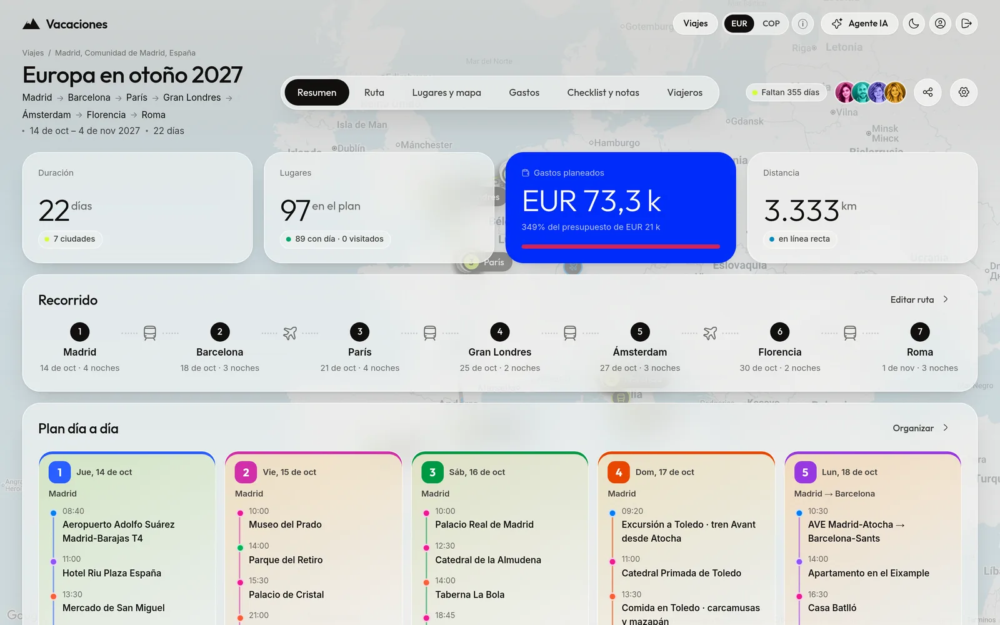
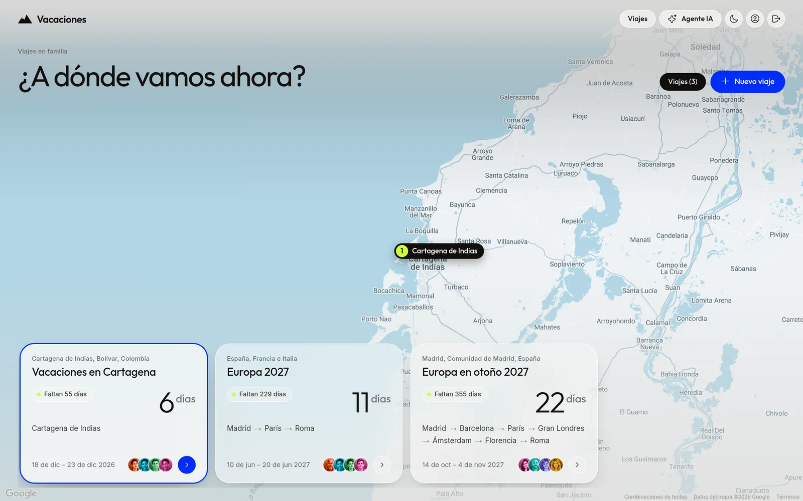
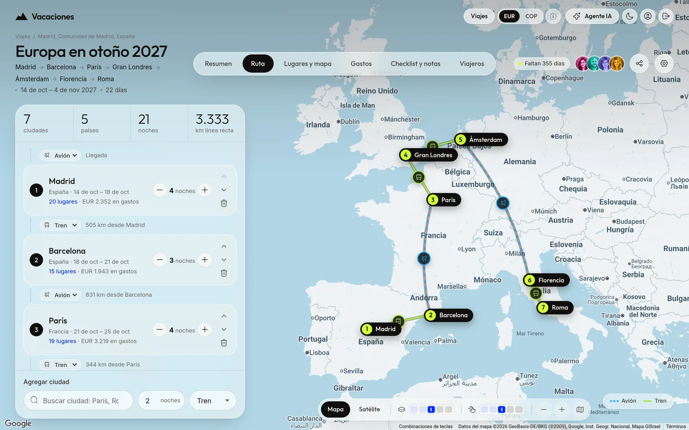
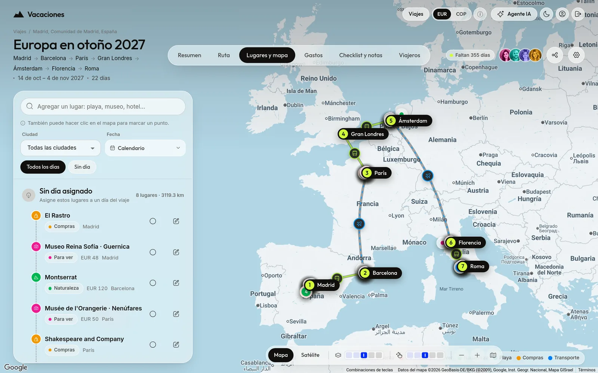
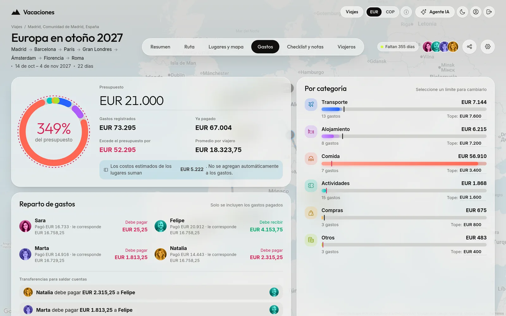
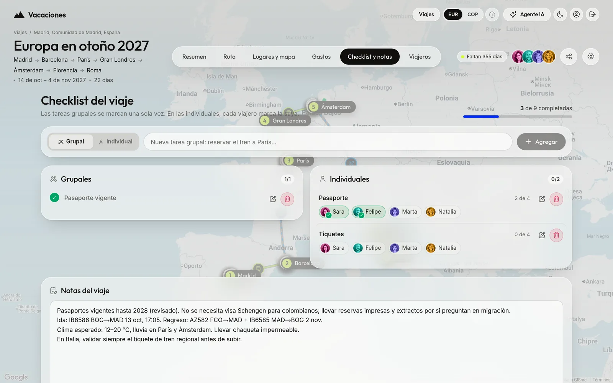
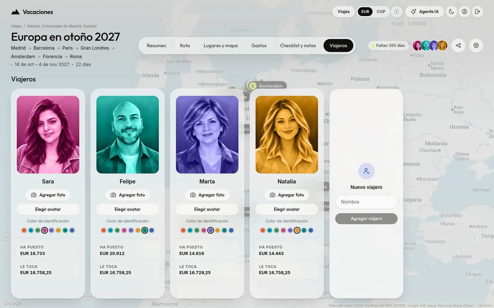
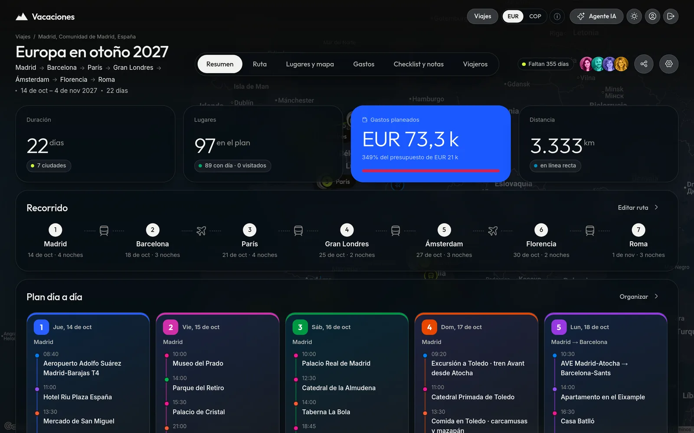

# Vacaciones en familia

Caso de estudio de como crear un Planeador de viajes familiares de una o varias ciudades (p. ej. Madrid → París → Roma), con el mapa como lienzo y la interfaz flotando encima.



## Qué incluye

- **Ruta:** ciudades en orden con noches, fechas y transporte entre paradas (avión, tren, bus, carro, barco).
- **Lugares y mapa:** lugares por día con hora, categoría y costo estimado; búsqueda con Google Places o Nominatim.
- **Gastos:** presupuesto por categoría, segunda moneda con tasa del día y «cuentas claras» entre viajeros.
- **Checklist y notas:** tareas grupales e individuales, y notas del viaje.
- **Viajeros y documentos:** retratos, colores y archivos protegidos (seguros, tiquetes, reservas).
- **Compartir:** enlace de solo lectura sin gastos ni checklist.
- **Agente IA:** servidor MCP para que un agente arme o edite viajes.
- **Tema claro y oscuro.**

**Tecnologías:** Bun · PocketBase · TypeScript · Svelte 5 + Vite · Google Maps / MapLibre (OpenFreeMap, Esri) · Nominatim.

## Capturas

| Inicio | Ruta |
| --- | --- |
|  |  |
| **Lugares y mapa** | **Gastos** |
|  |  |
| **Checklist y notas** | **Viajeros** |
|  |  |

Tema oscuro:



Las capturas usan el viaje de prueba que crea `bun run demo` (con `bun run dev` corriendo).

## Arrancar

```bash
bun run setup   # dependencias, PocketBase y .env
bun run dev     # web en http://localhost:3434, PocketBase en :8091
```

La primera cuenta (la admin) se crea sola con `ADMIN_USER` / `ADMIN_PASSWORD` de `.env`, y se entra con ese **usuario** y contraseña. Si cambias esas variables, al desplegar se aplican una vez a la cuenta admin; después cada quien cambia su contraseña desde la app.
Administración de PocketBase: http://127.0.0.1:8091/_/ con `PB_ADMIN_*`.

Producción: `bun run start` compila la web y PocketBase la sirve en un solo puerto.

## Estructura

- `pb/pb_migrations/` — colecciones: `trips`, `stops` (paradas), `travelers`, `places`, `expenses`, `checklist_items`.
- `scripts/` — descargar y arrancar PocketBase, modo desarrollo y producción.
- `web/src/lib/` — cliente de PocketBase, almacén del viaje en vivo, formatos, geocodificación, reparto de gastos.
- `web/src/routes/` — Inicio, viaje (Resumen, Ruta, Lugares y mapa, Gastos, Checklist, Viajeros y notas).
- `web/src/components/` — mapa, formularios, modal, avisos, anillo de presupuesto…

## Tema visual «Trail»

Inspirado en [TheTrail – RonDesignLab](https://dribbble.com/shots/26489961-TheTrail-Travel-App-Hiking-Web-Dashboard):

- **El mapa es el lienzo**: ocupa toda la pantalla y la interfaz flota encima (`.stage`).
- **Vidrio esmerilado**: `.card` y `.glass` con `backdrop-filter` y bordes de 26px.
- **Píldoras**: la activa en negro (`--pill-on`), el resto translúcidas; botones de icono redondos.
- **Acentos**: azul eléctrico para la tarjeta protagonista (`.card.hero`) y lima para rutas y señales.
- **Tipografía**: Outfit para títulos y cifras (`.big-num`, peso ligero con unidad pequeña), Inter para el texto.
- **Mapa**: capa satelital (Esri) o gris (OpenStreetMap), con controles en una cápsula flotante.

Todos los tokens están en `web/src/styles/global.css`, con su versión oscura.

La segunda moneda se configura en los ajustes de cada viaje. Para USD/COP se consulta la TRM oficial publicada por la Superintendencia Financiera en Datos Abiertos Colombia. Para otros pares se usa la tasa diaria de Exchange Rate API. La fecha y la fuente aparecen junto al selector; los importes se guardan en la moneda principal.

## Cuentas y enlaces para compartir

- **Cuentas:** el registro público está cerrado. Desde **Cuenta** (icono de persona en la barra superior), cualquier miembro crea una cuenta nueva: elige el nombre de usuario y el sistema sugiere una contraseña que se puede cambiar. Al crearla se muestran los datos para enviarlos a la persona; la contraseña no se vuelve a mostrar. Todas las cuentas ven y editan los mismos viajes.
- **Contraseña:** cada cuenta la cambia en **Cuenta → Mi cuenta** con su contraseña actual; las otras sesiones se cierran.
- **Admin:** la primera cuenta es admin y puede restablecer la contraseña de cualquier otra si se pierde; las sesiones de esa cuenta se cierran. Nadie puede darse permisos de admin por la API.
- **Solo lectura:** el botón **Compartir** de un viaje crea un enlace `#/compartido/TOKEN` que se abre sin sesión. Muestra origen, ruta, itinerario por día, mapa, viajeros y notas; gastos, presupuesto, costos y checklist quedan privados. «Crear uno nuevo» anula el anterior y «Desactivar» lo corta.

Las contraseñas nuevas tienen entre 10 y 72 caracteres. Las rutas viven en `pb/pb_hooks/cuentas.pb.js` y las pruebas en `tests/cuentas.test.ts`.

## Documentos del viaje

En **Viajeros → Documentos** se suben PDF o imágenes (JPG, PNG, WebP o HEIC, hasta 20 MB): seguros, tiquetes, entradas, reservas, documentos de identidad. Cada uno es de un viajero o de **todo el grupo**, y la lista se filtra por dueño.
- Los archivos son **protegidos**: solo se abren con un token temporal de una cuenta con sesión, nunca con el enlace de solo lectura.
- PocketBase revisa el contenido del archivo, no solo su extensión.
- Si se quita a un viajero, sus documentos pasan al grupo; si se borra el viaje, se borran con él.
- Al duplicar un viaje, los documentos no se copian.
- Entran en los respaldos diarios (`pb_data/storage`).

Las pruebas están en `tests/documentos.test.ts`.

## Google Maps y búsqueda de lugares

En `.env`, configure `GOOGLE_MAPS_BROWSER_KEY` (Maps JavaScript API, restringida al dominio) y `GOOGLE_PLACES_SERVER_KEY` (Places API New, restringida a la IP pública de salida del servidor). La segunda clave permanece en PocketBase; el navegador recibe solamente la clave del mapa después de iniciar sesión.

- `GOOGLE_MAPS_MONTHLY_LIMIT=8000`: reserva una carga antes de crear cada mapa de Google. Al agotarse las reservas, las siguientes aperturas usan MapLibre, OpenFreeMap y Esri. Los mapas ya abiertos permanecen disponibles y los marcadores conservan sus coordenadas.
- `GOOGLE_PLACES_MONTHLY_LIMIT=4000`: límite independiente de Text Search Pro. Se solicitan solamente identificador, nombre, dirección, coordenadas y tipo. Al agotarse o fallar Google, el buscador usa Nominatim. Buscar una ciudad al crear un viaje, agregar ciudades a la Ruta y agregar lugares usan este buscador. El clic directo en el mapa conserva la consulta inversa de Nominatim.
- Los contadores son privados, persistentes y compartidos en la base de datos de PocketBase; cada mes se contabiliza según la hora del Pacífico. Las solicitudes fallidas conservan su reserva para no subestimar el consumo. Un valor de `0` desactiva ese servicio; un límite inválido también lo desactiva.
- `GET /api/vacaciones/google/usage` muestra el consumo de la aplicación para usuarios autenticados. No incluye otros proyectos ni solicitudes hechas fuera de esta aplicación: los contadores no son una garantía de ausencia de cobros en la cuenta de Google.
- Los registros de `places` y `stops` conservan `geo_provider` y `google_place_id`, además de nombre, dirección y coordenadas. Por decisión del propietario, se conserva la visualización de estos marcadores con el proveedor alternativo. Queda pendiente su segunda revisión de las condiciones de Google sobre almacenamiento y mapas alternativos.

Reinicie `bun run dev` o `bun run start` después de editar `.env`. Los scripts cargan los hooks de `pb/pb_hooks/` y las nuevas migraciones automáticamente. En el despliegue deben incluirse ambas carpetas y preservarse `pb/pb_data/`. Si las búsquedas se prueban desde otra IP, la restricción de Places debe autorizar esa IP de salida.

Comprobación: `bun run typecheck`, `bun run build` y `bun test tests/google.test.ts`. Las pruebas usan una base temporal y claves ficticias; no consumen servicios de Google.

## MCP para agentes de planificación

Pulse **Agente IA** en la barra superior, disponible desde cualquier pantalla. Es una sola conexión por cuenta para todos los viajes: el agente puede consultarlos, crear viajes nuevos y editar cualquiera. El MCP está desactivado por defecto, también para tokens creados antes de esta opción. El interruptor del panel permite activarlo o desactivarlo por cuenta; mientras esté desactivado el servidor rechaza toda conexión MCP, aunque el token sea válido. El estado se guarda en PocketBase y renovar el token no cambia la activación. MCP muestra siempre el token de la cuenta, la URL del servidor, una configuración JSON y un mensaje inicial para el agente. El token es independiente de las claves Google y permanece hasta renovarlo. Se almacena en una tabla privada de PocketBase y solo una sesión de esa cuenta puede recuperarlo o renovarlo. Renovarlo revoca inmediatamente la conexión anterior.

**Lugar de origen:** cada viaje guarda la ciudad desde donde sale la familia (`origin`, campo «Sale desde»). Las instrucciones del MCP obligan al agente a preguntarlo antes de proponer la ruta si el viaje no lo tiene, y a usarlo para planear la ida, el regreso y sus gastos.

**Viaje armado por la IA:** en **Nuevo viaje → Con un agente IA** basta con el nombre. Se crea un viaje vacío y se abre el panel del agente; el mensaje para el agente ya incluye el `trip_id` y le indica completarlo con `update_trip` y `add_trip_items` en lugar de `create_trip`. Mientras el viaje no tenga ciudades, lugares ni viajeros, el Resumen muestra un acceso para conectar el agente.

Endpoint: `https://SU-DOMINIO/api/vacaciones/mcp`. Transporte **Streamable HTTP** sin sesiones ni SSE; respuestas JSON y autenticación `Authorization: Bearer TOKEN`. El cliente debe aceptar `application/json, text/event-stream`. La URL se adapta al dominio donde se abre la web. Un agente externo necesita alcanzar ese dominio por HTTPS; `localhost` solo sirve si el agente corre en la misma máquina. Clientes que solo admiten OAuth no pueden usar este token directamente. La configuración mostrada está destinada a clientes con URL HTTP y cabeceras personalizadas; adapte su sintaxis al cliente.

Herramientas:

- `get_context`: guía de planificación, categorías, monedas, fechas, índices y esquemas.
- `search_locations`: búsqueda de ciudades y lugares, con coordenadas y origen; comparte las cuotas de Places. Si no está disponible, el agente puede usar coordenadas verificadas por otra fuente o dejar el lugar sin coordenadas.
- `list_trips` y `get_trip`: viajes compartidos y todo su contenido.
- `create_trip`: crea viaje, ciudades, viajeros, lugares, gastos y checklist en una transacción.
- `update_trip`: modifica datos generales y notas, recalculando el regreso según las noches.
- `add_trip_items`: agrega elementos sin reemplazar los existentes, en una transacción.
- `update_trip_items`: edita ciudades, viajeros, lugares, gastos o checklist existentes por su `id`; solo cambia los campos enviados y recalcula el regreso.
- `delete_trip_items`: elimina elementos por su `id`, solo cuando el usuario lo pide. Ninguna herramienta borra viajes completos.

Se publica también el recurso `vacaciones://context` y el prompt `plan_vacation`. Los días empiezan en 1; 0 significa sin día. Las referencias usan índices desde 0. Las coordenadas son opcionales: el agente puede verificarlas con `search_locations` antes de enviarlas. Los gastos se registran como planeados por defecto; no se realizan reservas ni pagos. El token tiene el mismo alcance familiar que la aplicación; no permite borrar viajes ni ejecutar herramientas arbitrarias.

`create_trip` y `add_trip_items` requieren un `request_key` de 8–120 caracteres, reutilizado al reintentar la misma operación. Un error de datos o relaciones revierte todos los cambios. Los datos creados son visibles mediante las suscripciones existentes de la aplicación.

Por defecto se rechazan peticiones MCP con cabecera `Origin`. Para un cliente web, añada sus orígenes exactos a `MCP_ALLOWED_ORIGINS` (separados por coma); los agentes de servidor normalmente no envían `Origin`. No incluya el token en URLs. Los endpoints de configuración y MCP usan `Cache-Control: no-store`.

Incluya `pb/pb_hooks/` y `pb/pb_migrations/` en el despliegue. Reinicie PocketBase para cargar la migración y los hooks. Pruebas de conexión, permisos, creación completa, idempotencia, rollback y renovación: `bun test tests/mcp.test.ts` (servidor y datos temporales, sin llamadas a Google).

## Despliegue con Docker

`./desplegar.sh` copia el código por SSH al servidor (`DEPLOY_HOST`, por defecto `vigotes@64.23.130.221`, en `/home/vigotes/vacaciones`), construye la imagen Alpine allí y reinicia el contenedor con `docker compose`. El contenedor escucha solo en `127.0.0.1:8090`; el proxy inverso del servidor publica `https://vacaciones.wfelipe.com` y debe enviar `X-Forwarded-For`. Los datos viven en `/home/vigotes/vacaciones/pb_data`, fuera de `src/`.

### Respaldos

- **Diario (PocketBase):** a las 05:00 UTC (medianoche en Bogotá) PocketBase deja un `.zip` en `pb_data/backups` y conserva los últimos 7. Se ajusta en la consola (`/db/` → Settings → Backups).
- **Copia fuera del servidor (Proxmox):** a la 01:30 el CT 111 (`vigotes-backup`) entra como `pbbackup`, que solo puede leer `/srv/pb-export`. `pb-export.sh` copia ahí los `.zip` de cada app (`[vacaciones]=/home/vigotes/vacaciones/pb_data/backups`), y el CT los sube a Proxmox Backup Server como `host/vigotes`.
- **Antes de cada despliegue:** `desplegar.sh` para el contenedor, guarda `respaldos/pb_data-<fecha>.tgz` y conserva los últimos 5 (`VACACIONES_RESPALDOS`).
- **Primera vez con esta versión:** `desplegar.sh` copia el volumen anterior `vacaciones_datos` a `pb_data/`. El volumen no se borra; cuando compruebes que todo está bien, se elimina con `docker volume rm vacaciones_datos`.

Los respaldos incluyen las cuentas y los tokens del MCP: protégelos como `.env.production`.

La primera ejecución crea `.env.production` (no versionado) con contraseñas nuevas para la familia y el administrador, y copia las claves de Google de `.env`. El script se niega a desplegar con las contraseñas del ejemplo. `./desplegar.sh --logs` muestra los registros.
